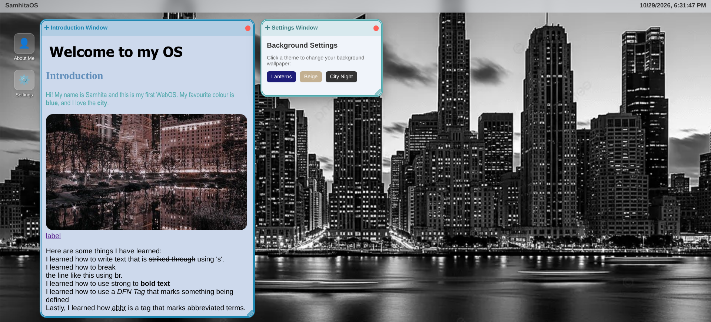

# Stardance_WebOS
A WebOS with an introduction window and a settings window that allows the user to change the background.

# Image

# Demo Link
https://stardancewebos.vercel.app/

# Quick Start
Open or click on the demo link.

# Features
- Two windows: one for the intoduction, and one for the settings.
- Can drag window with by dragging the icon at the top left corner.
- Can close the window with the red button at the top right corner.
- Can resize the window by dragging the bottom right corner.
- Can reopen the window by clicking on the icon for the specific window.

# Credits / Acknowledgements
I used the WebOS Hack Club guide (https://jams.hackclub.com/batch/webOS) to help me create this project. This was helpful with the DIV's and the buttons on the window.